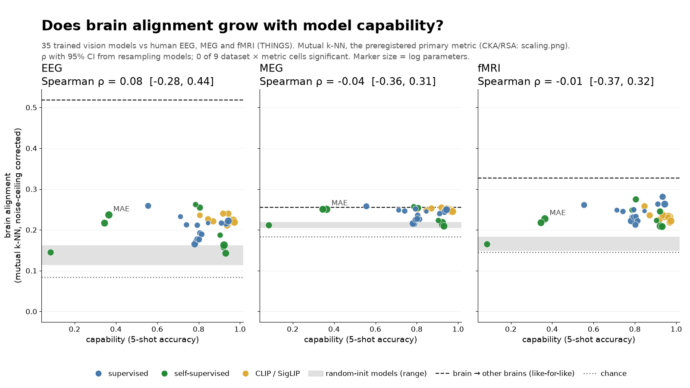
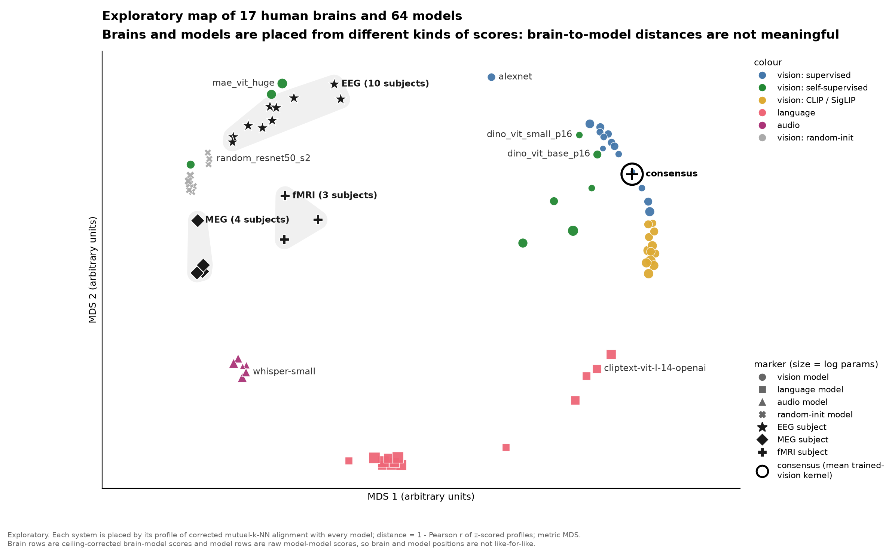

# Platonic Brain Index

Do human brains and AI models converge on one shared representation of objects as models get better? The
Platonic Representation Hypothesis (Huh et al. 2024) says capable models converge on each other. This project
asks whether they also converge on the brain. It scores 64 models (35 trained vision models, 9 random-init
networks, 12 language models, 2 sentence encoders, 6 audio models) against three human datasets (THINGS-EEG2,
THINGS-MEG, THINGS-fMRI inferior temporal cortex) with three metrics (mutual k-NN, debiased linear CKA, RSA), all
corrected for each subject's noise ceiling. It then tests six hypotheses that were preregistered before any score
was computed.

## Headline result

**More capable vision models were not detectably more brain-like, at least in their final embedding.** Across 35
trained vision models, the Spearman correlation between few-shot classification accuracy and
noise-ceiling-corrected brain alignment was near zero on the preregistered primary metric, mutual k-NN (EEG 0.08,
MEG −0.04, fMRI −0.01). Over all 9 dataset × metric cells it ranged from −0.68 to +0.26, and 0 of 9 cells were
significant after correction. The −0.68 is an MEG RSA cell that depends on how the RDMs are built (see limits).

This is an absence of evidence, not evidence of absence:
* Model-resampling 95% CIs reach up to 0.31–0.44 on mutual k-NN and 0.49–0.54 on CKA.
* CKA is weakly positive in all three datasets (ρ 0.13, 0.20, 0.26), though no cell is confirmed.
* With 35 models, a correlation below about 0.4 cannot pass the correction.

The readout matters too. The preregistered *secondary* representation is the best of 5 layers, chosen on half the
stimuli and scored on the other half. On it, capability does predict EEG mutual k-NN (ρ = 0.60, Holm p 0.002) and
MEG RSA (ρ = 0.48, Holm p 0.02), but not the other 7 cells (fMRI: −0.15 to 0.12). H2 would still fail its
threshold there, and this test was run post hoc (`artifacts/results/robustness.md`).

**Scale.** Within model families, the mean within-family correlation between parameter count and mutual k-NN
alignment was −0.37 (EEG; the CI excludes 0, but the negative trend is not significant, lower-tail p ≈ 0.06),
−0.28 (MEG) and −0.07 (fMRI). Families have only 3–5 sizes.

**What did hold.**
* Trained networks beat random-init networks on mutual k-NN and CKA in all three datasets. H1 as preregistered
  still failed (6/9 cells) because of the RSA cells.
* Models that agree more with other models also agree more with brains (H5; ρ = 0.59 EEG, 0.49 MEG, 0.41 fMRI).
  The fMRI cell does not survive dropping MAE or adjusting mutual k-NN for chance.
* On the same stimuli, capability does predict how much a model agrees with the other models (Spearman ρ on the EEG,
  MEG and fMRI stimuli: 0.58, 0.63, 0.62; 0.47–0.53 without MAE). That replicates PRH's convergence among models. Brains
  track how consensus-like a model is, but not how capable it is.

**Distance to brains.** The best corrected model score in any cell was 0.30. Other brains, scored like-for-like
(a subject's split halves against the other subjects' mean), sit well above every model on EEG (0.52–0.79) and on
fMRI CKA and RSA (0.42, 0.54). They are only slightly above on fMRI mutual k-NN (0.33 against 0.28). On MEG they
are about where the best models are (0.26–0.27). On MEG RSA the best model (0.30) exceeds them.

**Prior work.** This agrees with reports that neural alignment saturates or falls as accuracy rises (Linsley et
al. 2023; Gokce & Schrimpf 2025; Conwell et al. 2024). It differs from controlled-scaling results (Raugel et al.
2025), whose models vary only in size and data. What this repo adds:
* PRH's own metric, applied to EEG, MEG and fMRI and preregistered;
* the cross-model agreement test (H5).

**Review.** An independent AI reviewer agent, working blind from a clean clone of commit 5627443, got byte-identical
result files. It could not make the capability test pass under any variant it tried. The H4 rule change, the
robustness analyses, the layer-selected test and the figures came after that review. CI checks them against the
committed kernels. The independent review does not cover them.

These results cover three THINGS datasets with 10, 4 and 3 subjects; they do not include NSD.



*Capability (5-shot accuracy) against noise-ceiling-corrected mutual-k-NN alignment for the 35 trained vision models, one panel per dataset. Panel titles give Spearman ρ with a 95% CI from resampling models. Grey band = random-init range. Dashed line = like-for-like brain-to-other-brains reference (halves vs group: 0.52 / 0.26 / 0.33). Dotted line = chance in corrected units (0.08 / 0.18 / 0.15), which is above 0. The three low-capability green points are MAE. CKA and RSA: `figures/scaling.png`.*



*Exploratory 2-D layout of brains and models by their alignment profiles. Brain rows are ceiling-corrected
brain–model scores and model rows are raw model–model scores. Brain-to-model distances are therefore not
meaningful: brains landing near MAE, random-init and audio models is an artefact of the layout, not a finding. No
claim rests on this figure.*

## Preregistered predictions vs outcomes

Predictions and thresholds were committed in `PREREGISTRATION.md` (commit cbd0a89) before any analysis. "Confirmed"
in a cell = Holm-corrected permutation p < 0.05 across 9 cells **and** a 95% CI excluding 0.

| # | Hypothesis | My prediction | Outcome | Prediction right? | Key numbers |
|---|---|---|---|---|---|
| H1 | Trained vision models align better than random-init | Confirmed (9/9) | **FAIL**, 6/9 cells (needed 7); 9/9 with column-centred RSA (exploratory) | No | Trained − random, mknn: EEG 0.075, MEG 0.031, fMRI 0.077; CKA: 0.068, 0.100, 0.132; all confirmed. RSA: 0.028, 0.029, −0.077, none confirmed. With column-centred RDMs (exploratory) H1 is 9/9. |
| H2 (headline) | Alignment rises with capability | Fails the full threshold; about half the cells confirmed | **FAIL**, 0/9 cells | Yes (threshold only; "about half confirmed" was wrong) | ρ(capability, score), mknn / CKA / RSA: EEG 0.076 / 0.132 / 0.215; MEG −0.036 / 0.203 / −0.677; fMRI −0.007 / 0.264 / −0.259. fMRI mknn (n = 100, k = 5) depends on k: 0.24 at k = 10, 0.41 at k = 20 |
| H3 | Alignment rises with scale within families | Not confirmed | **FAIL**, 0/3 datasets | Yes | Mean within-family ρ(log params, mknn): EEG −0.367 [−0.517, −0.183], MEG −0.283, fMRI −0.067 |
| H4 | Language models given only the concept name align above chance; scale helps | Above chance for fMRI-IT and late EEG/MEG, no scale trend | **PARTIAL (FAIL)** | Yes | (a) The best LM beats the shuffled-stimulus null (corrected for picking the best) in 7/9 cells, including the preregistered fMRI-IT mknn cell (0.209, Holm p 0.009). EEG and MEG are tested on the 80–500 ms window, not late time points. The best LM is usually a CLIP text tower, which was trained jointly with images. Among pure LMs, Pythia-1B (0.204) also beats its family null on fMRI mknn (uncorrected p 0.001). (b) LM scale trend ρ = 0.107 [−0.343, 0.914], not confirmed. H4 passes under the literal preregistered reading (point estimate ρ > 0); after the review it is judged with the cell rule (`DEVIATIONS.md`) |
| H5 | Models that agree with other models agree with brains | Confirmed | **PASS**, 3/3 datasets | Yes | ρ (mknn): EEG 0.595, MEG 0.487, fMRI 0.406 |
| H6 | No model reaches the noise ceiling | Confirmed | **PASS**, 9/9 cells | Yes | Best corrected score 0.21–0.30 per cell. Preregistered brain reference, full kernel vs group (mknn / CKA / RSA): EEG 0.60 / 0.86 / 0.80, MEG 0.29 / 0.44 / 0.37, fMRI 0.40 / 0.63 / 0.71. This reference overstates the comparison. Like-for-like (halves vs group): EEG 0.52 / 0.79 / 0.75, MEG 0.26 / 0.27 / 0.26, fMRI 0.33 / 0.42 / 0.54. The MEG RSA best model (0.298) exceeds it |

**Tally: 5 of 6 predictions correct.** The wrong one is H1, and its failing cells depend on how RSA builds its
dissimilarity matrices (see below). For H2, the threshold-level prediction ("fails") was right, but its details
were not: I expected about half the cells to be confirmed, and none were.

Full numbers for every cell: [`RESULTS.md`](RESULTS.md) and
[`artifacts/results/hypotheses.md`](artifacts/results/hypotheses.md).

## What this does and doesn't show

It shows that, on these data, a model's few-shot capability did not detectably predict how brain-like its final
embedding is, that within-family scale did not either, and that cross-model agreement does predict brain
agreement. It does not show that no form of convergence exists, nor that small capability effects are absent.
Limits:

* **Three datasets, all THINGS.** EEG2 (10 subjects, 200 images, 80 repetitions), MEG (4 subjects, 200 images,
  12 repetitions), fMRI (3 subjects, 100 images, 12 repetitions). NSD (needs a signed data-use agreement), NOD and
  BOLD5000 (raw releases needing a GLM pipeline) are not included; see `BLOCKERS.md`.
* **Small subject counts for MEG and fMRI**, and **low MEG reliability**: MEG split-half ceilings are 0.03–0.23
  (participants 1 and 4 lowest). MEG leave-one-subject-out ranking consistency for RSA is 0.40.
* **fMRI is IT cortex only** (released IT mask, 3,022–4,145 voxels per subject). Early visual cortex is not tested.
* **RSA cells depend on how the RDMs are built.** The preregistered correlation-distance RDM keeps each feature's
  mean pattern. With column-centred RDMs (exploratory), H1 passes 9/9 and the negative RSA correlations in H2
  (MEG −0.68, fMRI −0.26) become positive but still unconfirmed. Read negative RSA cells as "not confirmed", not as
  "capability hurts".
* **Corrected mutual k-NN has a chance floor above 0**: 0.08 (EEG), 0.15 (fMRI), 0.18 (MEG) in corrected units.
  MEG mutual k-NN barely separates models, and H6 passing there is close to trivial.
* **MAE embeddings are the CLS token.** The MAE objective does not directly supervise it, and MAE features are
  known to be weak under frozen k-NN or linear readout. MAE capability is therefore very low (0.08–0.36), even
  though MAE ViT-L/H rank high on alignment. H2 still fails without MAE.
* **Capability is one proxy**: 5-shot nearest-centroid accuracy on 600 THINGS-EEG2 training concepts, using the
  same embedding that is scored against brains. It is a geometry measure, not the downstream-transfer measure Huh
  et al. used.
* **Capability is compressed.** 24 of 35 models score between 0.80 and 0.97. The test mostly contrasts MAE, AlexNet
  and small ResNets with everything else. Among the 24 models above 0.8, H2 on mutual k-NN is 0.15 / 0.10 / −0.10.
* **Final embedding only** in the primary analysis. The preregistered secondary layer analysis (best of 5 depths,
  selected on half the stimuli, scored on the other half) gives a positive capability correlation on EEG mutual
  k-NN (ρ = 0.60) and MEG RSA (ρ = 0.48), both surviving Holm. MEG CKA is 0.38 (Holm p 0.09). The other cells
  show none (fMRI |ρ| ≤ 0.15). H2 still fails its threshold under this readout: mutual k-NN is confirmed in 1 of 3
  datasets. The null on the final embedding therefore partly reflects the readout. The layer test is post hoc and
  scored on half the stimuli (see `robustness.md`).
* **EEG/MEG patterns are flattened over 80–500 ms**, which weights early, low-level responses. Capability may relate
  to later or IT-level structure, and a time-resolved H2 was not run.
* **No audio-visual models.** Common open ones reuse a CLIP image tower, which is already scored.
* **Language and audio models see only the concept name** ("A photo of a/an {concept}.", or its spoken form via
  TTS), not the image.

## Leaderboard (top 10)

Descriptive only: the index averages cells with different chance floors and the preregistered RSA definition, so
the ranking is not a validated brain-likeness ranking. For example, MAE ViT-H is #2 here but #12 on the
exploratory alternative index ("alt #"), because its rank comes from the RSA artefact. Full table, caveats and an exploratory alternative index:
[`LEADERBOARD.md`](LEADERBOARD.md).

| # | Model | Kind | Capability | PBI | 95% CI |
|---|---|---|---|---|---|
| 1 | brain_heldout (overstates; see `robustness.md`) | reference | – | 0.567 | [0.538, 0.611] |
| 2 | mae_vit_huge | SSL vision | 0.364 | 0.219 | [0.204, 0.241] |
| 3 | alexnet | supervised vision | 0.554 | 0.213 | [0.202, 0.227] |
| 4 | consensus (mean of trained vision kernels) | reference | – | 0.210 | – |
| 5 | dino_vit_base_p16 | SSL vision | 0.805 | 0.207 | [0.196, 0.222] |
| 6 | dino_vit_small_p16 | SSL vision | 0.785 | 0.206 | [0.195, 0.221] |
| 7 | clip_vit_b_32_laion2b | CLIP image tower | 0.919 | 0.197 | [0.182, 0.215] |
| 8 | mae_vit_large | SSL vision | 0.344 | 0.194 | [0.178, 0.211] |
| 9 | vit_large_p16_in21k | supervised vision | 0.944 | 0.188 | [0.177, 0.205] |
| 10 | vit_base_p16_in21k | supervised vision | 0.932 | 0.188 | [0.177, 0.203] |

PBI = mean noise-ceiling-corrected alignment over 3 datasets × 3 metrics.

## Reproduce

One command regenerates every result, the leaderboard and the figures from the committed stimulus kernels. CPU
only, no downloads, about 2–4 minutes on an M2 Pro with no cache: 222 s in the reviewer's run, 251 s with `--jobs 5`.

```bash
python -m venv .venv && .venv/bin/pip install -r requirements.txt
.venv/bin/python -m pbi reproduce --jobs 5        # or: make reproduce
.venv/bin/python -m pytest -q tests              # or: make test (reproduce does not run the tests)
```

To check a regenerated copy against another one:

```bash
python -m pbi check --against <dir with hypotheses.csv, scores.csv, leaderboard.csv>
```

**Engine cache.** The subsample / null / permutation engine caches results in `.cache/stats/` inside the
repository (git-ignored), keyed on the kernel files, the settings and a hash of the engine's source code, so a fresh
clone always recomputes and a code change never reuses stale results. `PBI_CACHE=0` disables the cache;
`PBI_CACHE=<dir>` moves it.

**Full rebuild from raw data.** `python -m pbi full` (or `make full`) rebuilds stimuli, brain kernels and model
kernels, then runs `reproduce`. It needs `requirements-full.txt` and about 40 GB of raw data under `$PBI_DATA`
(default `~/pbi_data`). There is no download module, because the datasets are licence-gated; the command prints
where each dataset must be placed. THINGS images are never committed (research-only licence); only derived n × n
stimulus kernels are.

## Add a model or a dataset

The GitHub Action (`.github/workflows/pbi.yml`) re-runs the tests and the full rescoring on every push or pull
request that touches code, kernels or the model registry. It fails if the committed results do not match what the
committed kernels produce.

1. **Vision model:** register it in `pbi/models.py`, then run `python -m pbi.models --models <id>`.
   **Language or audio model:** `python -m pbi.text_audio --models <id>`. Either writes
   `artifacts/kernels/{dataset}/model/<id>.npz` for each dataset and a metadata row in
   `artifacts/models_vision.csv` or `artifacts/models_langaudio.csv`. You can also commit kernels computed
   elsewhere: `np.savez_compressed(path, **pbi.kernels.pack(pbi.kernels.kernels_from_features(X)))`, with `X` the
   embeddings of `artifacts/stimuli/{dataset}.csv` in index order.
2. Run `python -m pbi reproduce` and commit the regenerated `artifacts/results/`, `LEADERBOARD.md` and `figures/`.
3. Open a pull request; CI checks the results against the kernels.

A new **dataset** needs a stimulus list in `artifacts/stimuli/`, brain kernels per subject with split halves
(`pbi/brains.py`), and model kernels for the new stimuli. The preregistered hypotheses cover only the three THINGS
datasets, so results on a new dataset are exploratory.

## Repository map

| Path | What it is |
|---|---|
| `PREREGISTRATION.md` | Analysis plan and predictions, committed (cbd0a89) before any score was computed |
| `RESULTS.md` | Full results write-up: methods, every hypothesis cell, exploratory analyses, review, limits |
| `DEVIATIONS.md` | Every deviation from, or specification of, the plan |
| `REVIEW.md` | Blind review by an independent AI reviewer agent from a clean clone (unedited), and the response to it |
| `BLOCKERS.md` | What could not be done and why |
| `LITERATURE.md` | Prior work this builds on |
| `LEADERBOARD.md` | Per-model index (descriptive) |
| `artifacts/results/` | `hypotheses.md` / `.csv` (verdicts and cells), `robustness.md` / `.csv`, scores, ceilings, nulls |
| `artifacts/kernels/` | Committed n × n stimulus kernels for every brain subject and model |
| `figures/` | Headline plot, map of minds, scaling, family scaling, time-resolved EEG/MEG |
| `pbi/` | Pipeline: `stimuli`, `brains`, `models`, `text_audio`, `capability`, `kernels`, `score`, `stats`, `robustness`, `leaderboard`, `figures` |
| `tests/` | Metric, statistics and end-to-end tests |

## What's next

* **More datasets:** NSD (once a data-use agreement is signed), NOD and BOLD5000, to test whether the null holds
  beyond THINGS and beyond IT cortex.
* **Encoding-model metrics** (cross-validated linear predictivity) alongside the kernel metrics.
* **A preregistered layer-selected H2**, with stimulus-subsample CIs and all stimuli, to test the post-hoc
  layer-sweep signal (EEG mutual k-NN, MEG RSA) on fresh data.
* **Time-resolved H2** on EEG/MEG, to separate early from late responses.
* **Video and audio-visual models** with stimuli that have a native audio track.
* **More subjects and repetitions** for MEG and fMRI, so ceilings sit well above the mutual k-NN chance floor.
* **Controlled-scaling families** (same data and recipe, only size varies), so scale is not confounded with
  training data and objective.

## Prior work and citation

This project builds on the Platonic Representation Hypothesis (Huh, Cheung, Wang, Isola 2024), Brain-Score
(Schrimpf et al. 2020), Conwell et al. (2024), Gokce & Schrimpf (2025) and the THINGS datasets (Hebart et al. 2023;
Gifford et al. 2022). The full list, with links and how each relates to this result, is in
[`LITERATURE.md`](LITERATURE.md).

```bibtex
@misc{davis2026platonicbrainindex,
  author = {Davis, Manav},
  title  = {Platonic Brain Index: does model--brain alignment rise with model capability?},
  year   = {2026},
  url    = {https://github.com/MDavis3/platonic-brain-index}
}
```

See also: [`REVIEW.md`](REVIEW.md) (blind review and response), [`DEVIATIONS.md`](DEVIATIONS.md),
[`BLOCKERS.md`](BLOCKERS.md).
